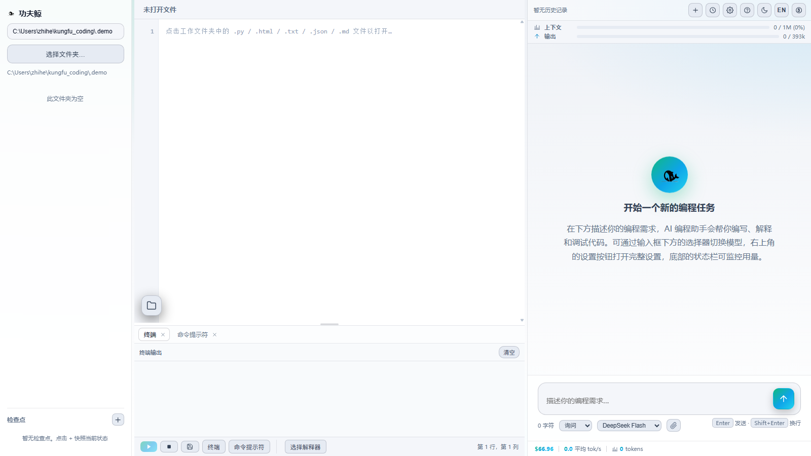
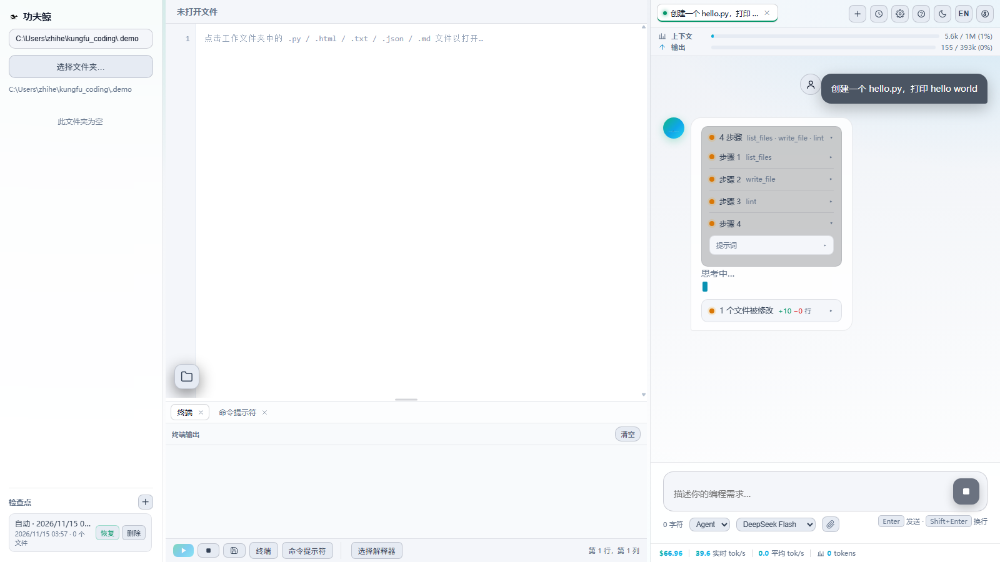
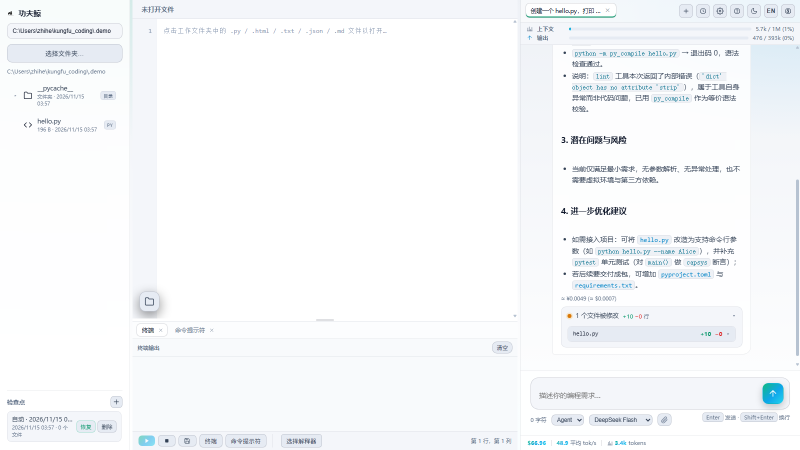
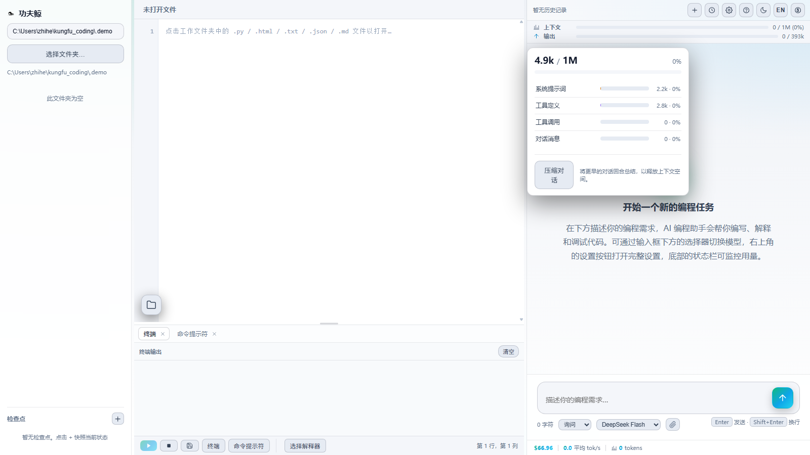
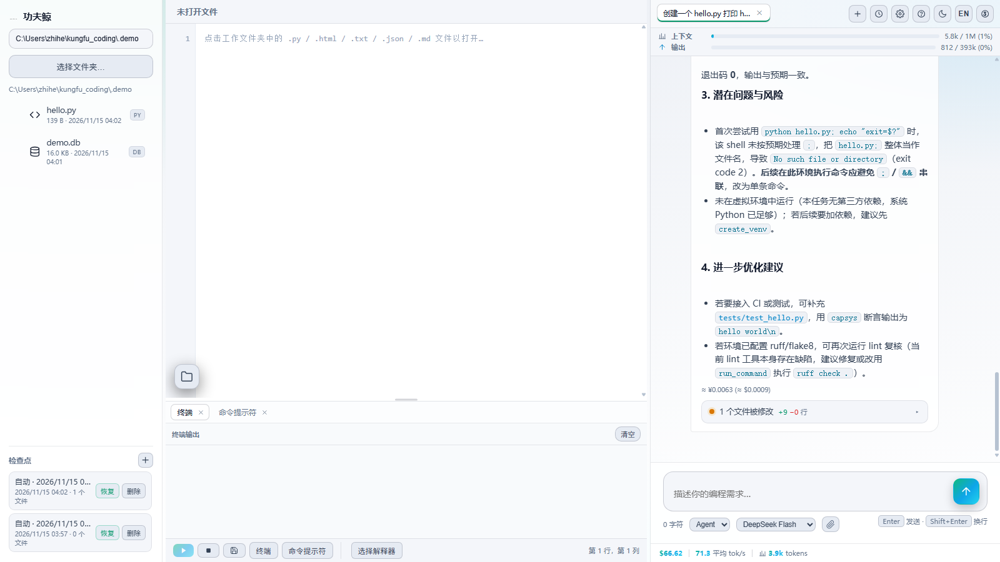
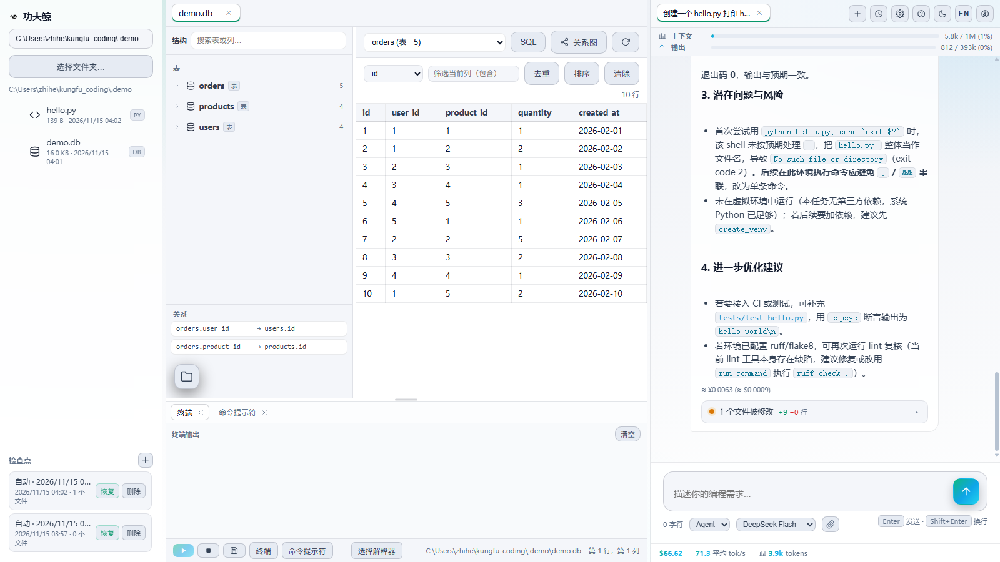
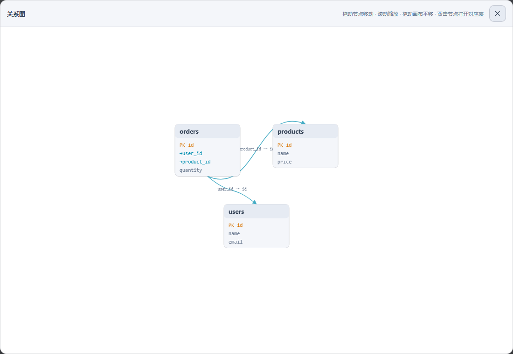

# 功夫鲸（Kung Fu Whale）—— DeepSeek AI 编程助手

一个**本地自托管**的 AI 编程助手 Web 应用，由 **DeepSeek** 大模型驱动。通过一个 API Key，即可在浏览器里与模型实时对话、查看**思考过程（Chain of Thought）**、实时监控 **Token 用量与生成速度**，并让一个**智能体（Agent）循环**在工作目录内自动读取、编写、编辑、测试和运行代码。

应用为 **DeepSeek 专属**：一个密钥即可解锁所有 DeepSeek 模型，无需配置其他服务商。

> 中文 | [English](README_en.md)

[](LICENSE)
[](https://www.python.org/)

---

## ✨ 功能特性

- 💬 **流式对话** — ChatGPT 风格气泡、打字机效果、可中途停止生成、多会话历史记录。
- 🧠 **深度思考** — 默认开启思考模式，推理链实时流式展示（可折叠）。
- 🎚 **模型与思考等级** — 支持 `deepseek-flash` / `deepseek-v4-pro`，思考等级 low / medium / high。
- 🌐 **中英双语** — 顶部一键切换界面语言；模型会自动跟随对话语言（中文提问就用中文思考与回答）。
- 🌗 **明暗主题** — 顶部切换浅色 / 深色主题（默认浅色，偏好会被记住）。
- 🤖 **智能体（Agent）循环** — 自动探索、规划、读写、编辑、删除文件，运行测试与命令，支持三种权限模式（Plan / Ask / Agent）。
- 📋 **进程可视化** — 智能体每一步（思考、工具调用、工具结果）实时展开为任务列表，完成后自动收起。
- 🗄 **数据库查看器** — 点击 `.db` 文件即可可视化浏览表 / 视图 / 字段结构、数据表格（筛选、排序、去重），并一键生成表关系图，高效管理 SQLite 数据库。
- 🔍 **联网搜索** — 内置 `web_search` / `web_fetch` 工具，按需联网查证，可读取网页链接。
- 📎 **文件附件** — 拖拽、粘贴或选择图片 / PDF / Word / Excel，自动提取文本并删除式管理。
- 📊 **上下文管理** — 顶部实时展示上下文（输入）与输出 Token 用量，悬停可查看「系统提示词 / 工具定义 / 工具调用 / 对话消息」细分明细，支持一键压缩对话。
- 🧮 **代码与公式** — highlight.js 高亮代码、KaTeX 渲染公式、HTML 块支持「▶ 运行」预览。
- 🧩 **大文件分段写入** — 智能体分块写入大文件，失败自动缩小分块。
- 💰 **余额监控** — 实时余额显示 + 单次交互成本估算（人民币/美元双币种、峰谷折扣）。
- 🛠 **文件差异附录** — 每次编辑后自动展示文件变更（红色删除、绿色新增）。
- 🖥 **内置工具链** — 文件浏览器、代码编辑器、终端、Python 运行器、检查点（快照/恢复）。
- ⚡ **零框架依赖** — 后端仅用 Python 标准库 `http.server` + `openai` SDK。

---

## 📸 界面预览与演示

**让智能体制作一个「2048」数字滑动游戏（完整演示动画）：**


**2048 游戏运行效果：**


**界面截图：**

| 首页 | 智能体实时工作 |
| --- | --- |
|  |  |

| 文件差异附录 | 上下文管理器（悬停查看细分） |
| --- | --- |
|  |  |

| 智能体任务列表（展开的进程） |
| --- |
|  |

| 数据库查看器 | 表关系可视化 |
| --- | --- |
|  |  |

---

## 🏗️ 软件架构

### 整体架构

```
┌────────────────────────────────────────────────────┐
│                    浏览器（index.html）              │
│  单页应用：聊天 UI / 设置 / 文件浏览器 / 编辑器 / 终端 │
└──────────────────────┬─────────────────────────────┘
                       │ HTTP + SSE（Server-Sent Events）
┌──────────────────────▼─────────────────────────────┐
│                 Python 后端（http.server）           │
│  ┌──────────┐  ┌──────────┐  ┌───────────────────┐  │
│  │ server.py │  │ agent.py │  │  tools/（文件/命令/ │  │
│  │ 路由+SSE  │  │ 智能体循环│  │ 数据库/联网/测试…）│  │
│  └──────────┘  └──────────┘  └───────────────────┘  │
│  ┌──────────┐  ┌──────────┐  ┌───────────────────┐  │
│  │ config.py │  │ common.py│  │ session/checkpoint │  │
│  │ 集中配置   │  │ 共享状态  │  │ 会话/快照持久化     │  │
│  └──────────┘  └──────────┘  └───────────────────┘  │
└──────────────────────┬─────────────────────────────┘
                       │ openai SDK
┌──────────────────────▼─────────────────────────────┐
│              DeepSeek API（chat / tools）            │
└────────────────────────────────────────────────────┘
```

### 目录结构

```
kungfu-whale/
├── app.py              # 入口：端口管理、启动、公共导出
├── server.py           # HTTP 服务：路由、SSE、文件浏览、终端、优雅关闭
├── agent.py            # 智能体循环：模型-工具调度、权限模式、进度、取消
├── common.py           # 共享运行时状态、Token 估算、上下文压缩、SSE 助手
├── config.py           # 集中配置（支持环境变量覆盖，DeepSeek 专属）
├── checkpoints.py      # 工作目录快照 / 恢复
├── session.py          # 智能体会话持久化（.sessions/*.json）
├── python_env.py       # Python 环境探测与虚拟环境激活
├── api_template.py     # DeepSeek 原始调用模板（复用 config.py）
├── index.html          # 单页前端：聊天 UI、设置、i18n（中/英）、附件、引导
├── whale-logo.svg      # 应用图标（功夫鲸）
├── tools/              # 智能体工具实现（文件、命令、数据库、lint、测试、联网、交互）
├── tests/              # 测试套件（无需联网）
├── LICENSE             # Apache-2.0 许可证
├── NOTICE              # 版权声明
├── pyproject.toml      # 项目元数据 / 构建配置
├── requirements.txt    # Python 依赖
└── README*.md          # 说明文档
```

---

## 📦 安装教程

### 环境要求

- **Python 3.8+**
- `openai` SDK（见 `requirements.txt`）
- 一个 **DeepSeek API Key**（`sk-…`，到 <https://platform.deepseek.com/api_keys> 获取）

### 安装步骤

```powershell
# 1. 克隆仓库
git clone https://gitee.com/zhihengdeng/kungfu-whale.git
cd kungfu-whale

# 2.（推荐）创建并激活虚拟环境
python -m venv .venv
.venv\Scripts\Activate.ps1      # Windows
# source .venv/bin/activate     # macOS / Linux

# 3. 安装依赖
pip install -r requirements.txt

# 4.（可选）配置密钥：复制 .env.example 为 .env 并填入 DEEPSEEK_API_KEY
# copy .env.example .env

# 5. 启动服务（默认 http://127.0.0.1:8888）
python app.py

# 如需指定端口
python app.py --port 8080
```

启动后浏览器会自动打开 **http://127.0.0.1:8888**。首次打开会依次弹出：用户指南 → 密钥设置（若未检测到有效密钥）→ 选择工作文件夹 → 欢迎窗口。也可以在右上角 ⚙ **设置** 中手动填写 API Key。

### 端口说明（默认 8888）

- 应用**默认固定使用 8888 端口**。
- 若 8888 被占用（如上次未正常关闭的实例），应用会**自动关闭冲突进程并重新在 8888 上启动**，而不会静默切换端口。
- 关闭应用（Ctrl+C / Ctrl+Break / 关闭控制台）时会释放端口并终止子进程（终端 / 运行中的脚本），方便下次启动。

---

## 🚀 使用说明

### 1. 配置密钥与模型

点击右上角 ⚙ 打开**设置**：

1. **DeepSeek API Key** — 唯一凭证，仅保存在服务端内存中，不落盘。
2. **模型** — `deepseek-flash`（快速、支持图像）或 `deepseek-v4-pro`（能力更强）。
3. **思考模式 / 思考等级** — 默认开启，可调 low / medium / high。
4. **Temperature / Top-p / Max tokens** — 采样参数（默认 0.2 / 0.95 / 393216）。

### 2. 选择工作文件夹

在左侧面板输入路径回车，或点击「选择文件夹…」使用系统原生对话框。智能体只会在此文件夹内读写文件。

### 3. 权限模式

输入框左下方的模式选择器控制智能体的自动程度：

| 模式 | 行为 |
| --- | --- |
| `Plan` | 只读规划：探索并产出落地方案，不修改文件、不运行命令 |
| `Ask`（默认） | 智能体模式：写文件 / 编辑 / 删除 / 命令前需用户确认 |
| `Agent` | 全自动：所有工具与命令立即执行，无需确认，请谨慎使用 |

### 4. 其他功能

- **联网搜索**：无需开关，模型按需自动调用 `web_search` / `web_fetch`；不确定时它会先向你确认。
- **文件附件**：拖拽 / 粘贴文件到输入框，自动提取文本。
- **上下文管理**：顶部上下文条点击可查看明细，支持「压缩对话」释放上下文。
- **文件差异**：每次智能体编辑后，回复下方会显示红/绿差异附录；点击文件路径可直接在编辑器中打开。
- **检查点**：修改文件前自动创建快照，可随时恢复。

---

## ⚙️ 配置

所有配置集中在 [`config.py`](config.py)，并支持环境变量覆盖。密钥可放在本地 `.env` 文件（见 [`.env.example`](.env.example)），启动时自动加载且已被 gitignore，不会进入版本控制。

| 环境变量 | 默认值 | 说明 |
| --- | --- | --- |
| `DEEPSEEK_API_KEY` | _(空，必填)_ | DeepSeek API Key（也可在设置中填写） |
| `DEEPSEEK_BASE_URL` | `https://api.deepseek.com` | DeepSeek API 地址 |
| `DEEPSEEK_MODEL` | `deepseek-flash` | 默认模型 |
| `DEEPSEEK_V4_PRO_MODEL` | `deepseek-v4-pro` | 高能力模型 |
| `DEEPSEEK_REASONING_EFFORT` | `high` | 默认思考等级（low / medium / high） |
| `LLM_CHAT_PORT` | `8888` | Web 服务端口 |
| `LLM_TIMEOUT` | `300` | 单次请求超时（秒） |
| `LLM_MAX_CONCURRENT` | `2` | 最大并发生成数 |
| `LLM_MAX_WAIT` | `60` | 等待并发槽位最长时间（秒） |
| `LLM_MAX_READ_BYTES` | `1048576` | 单次读取文件大小上限（字节） |
| `LLM_EDIT_CHUNK_CHARS` | `4000` | 智能体每次写入的分块大小（字符） |
| `LLM_AGENT_MAX_ITERS` | `200` | 智能体验证/修复循环上限 |

---

## 🤝 参与贡献

感谢你的关注！欢迎以以下方式参与：

1. **Fork 本仓库** — 点击右上角「Fork」复制仓库到你的账号。
2. **新建分支** — 分支命名建议：`Feat_xxx`（新功能）、`Fix_xxx`（修复）、`Docs_xxx`（文档）。
   ```bash
   git checkout -b Feat_xxx
   ```
3. **提交代码** — 遵循现有代码风格，提交信息清晰描述改动。
   ```bash
   git add .
   git commit -m "feat: 新增 xxx 功能"
   ```
4. **新建 Pull Request** — 推送到你的仓库后，在 Gitee 上发起 Pull Request，描述清楚改动内容与动机。

提交前请确认：

- ✅ 未包含任何密钥 / 个人敏感信息（`.env` 已被 gitignore）。
- ✅ 通过了 `python -m pytest` 测试。
- ✅ 代码与现有风格一致。

---

## 📄 许可证

本项目采用 [Apache License 2.0](LICENSE) 开源。版权归 **Zhiheng Deng（邓之恒）** 所有，详见 [NOTICE](NOTICE)。

---

## ⚠️ 免责声明

本应用需要你自行提供 DeepSeek API Key，所有 API 调用将产生费用。请妥善保管你的密钥，切勿提交到公开仓库。使用智能体（Agent）全自动模式前，请确认工作目录内容安全，并对重要文件做好备份。
