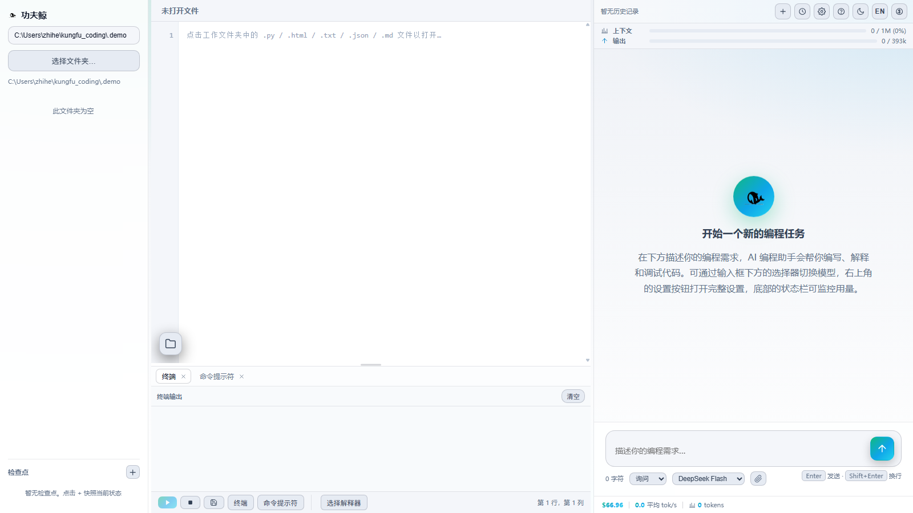
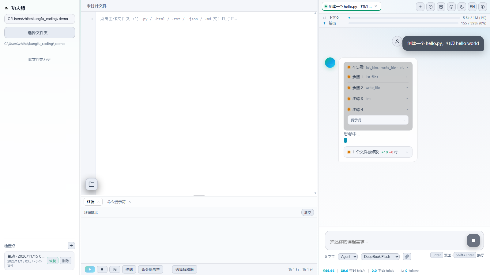
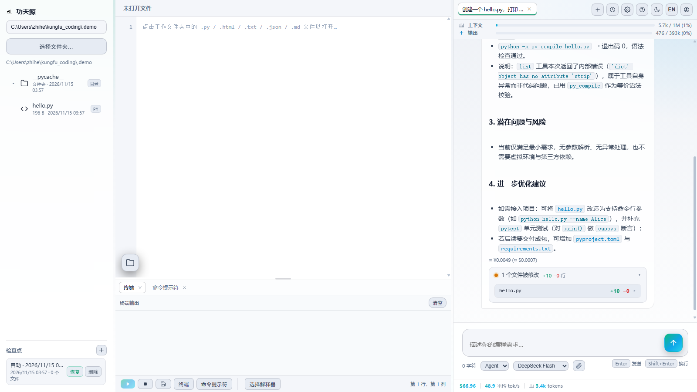
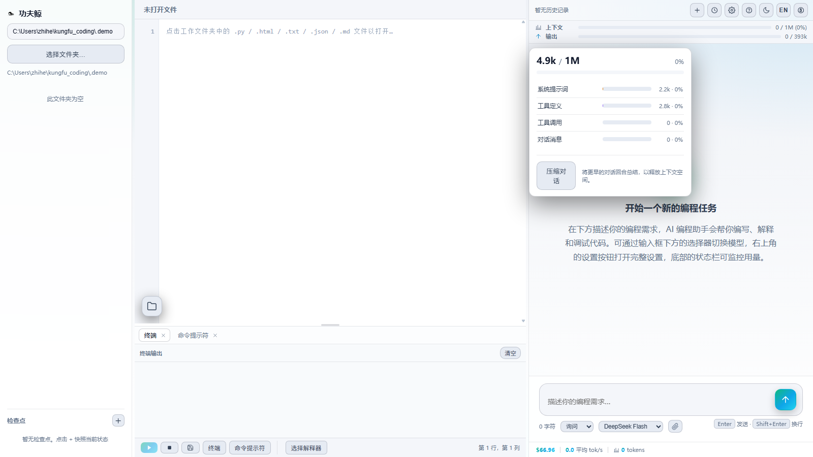
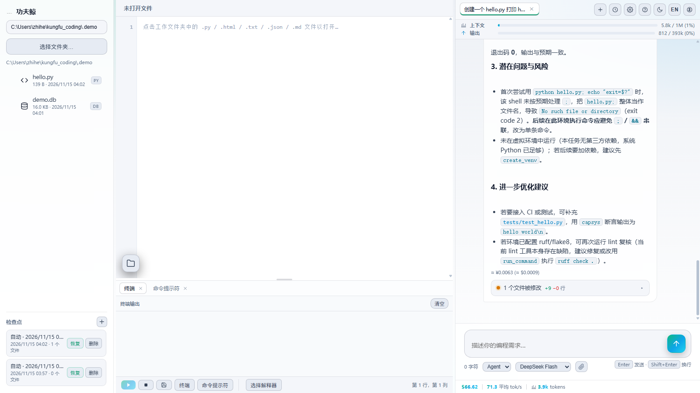
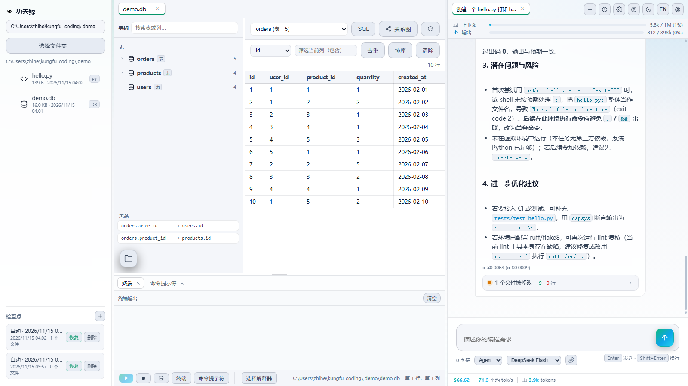
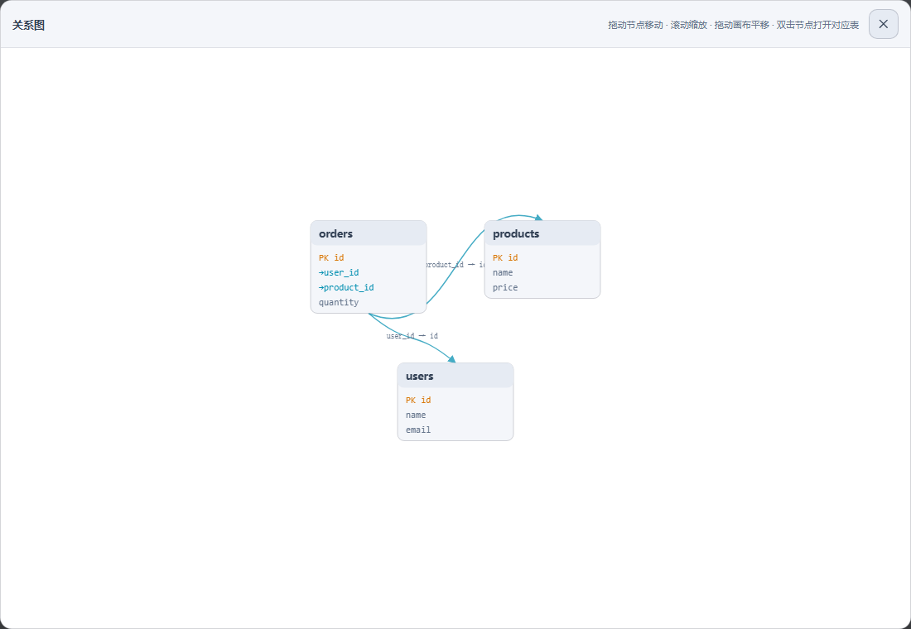

# Kung Fu Whale（功夫鲸）— DeepSeek AI Programming Assistant

A **local, self-hosted** AI programming-assistant web app powered by **DeepSeek**. Chat with the model in real time, watch its **reasoning (Chain of Thought)**, monitor **token usage and generation speed live**, and let an **agent loop** read, write, edit, test, and run code inside a working folder — all through a single DeepSeek API key.

The app is **DeepSeek-only**: one API key unlocks every DeepSeek model. There is no other provider to configure.

> [中文](README.md) | English

[](LICENSE)
[](https://www.python.org/)

---

## ✨ Highlights

- 💬 **Streaming chat** — ChatGPT-style bubbles with a typewriter effect, stop-generation, and multi-session history.
- 🧠 **Thinking by default** — the reasoning chain streams in real time (collapsible).
- 🎚 **Model + thinking level** — choose `deepseek-flash` / `deepseek-v4-pro` and a thinking level (low / medium / high).
- 🌐 **English / 中文** — one-click UI language switch; the model automatically matches the conversation language.
- 🌗 **Light / dark theme** — a toggle in the top bar (defaults to light; remembered).
- 🤖 **Agent loop** — explore, plan, write, edit, delete files, run tests, and execute commands, with three permission modes (Plan / Ask / Agent).
- 📋 **Process visualization** — each agent step (thinking, tool calls, results) expands live as a task list, auto-collapsing on completion.
- 🗄 **Database viewer** — click a `.db` file to visually browse tables / views / columns, inspect data (filter, sort, dedupe), and one-click generate a table-relationship graph for efficient SQLite management.
- 🔍 **Web search** — built-in `web_search` / `web_fetch` tools pull live information on demand.
- 📎 **File attachments** — drag, paste, or pick images / PDF / Word / Excel; text is extracted automatically.
- 📊 **Context manager** — a top monitor for input + output tokens; hover for a per-category breakdown (system prompt / tool definitions / tool calls / conversation) and one-click conversation compaction.
- 🧮 **Code & math** — highlight.js for code, KaTeX for LaTeX, and a "▶ Run" preview for HTML blocks.
- 🧩 **Piecewise large-file editing** — writes big files in bounded chunks and auto-shrinks on failure.
- 💰 **Balance monitor** — live balance + per-interaction cost estimate (CNY/USD, peak/off-peak pricing).
- 🛠 **Diff appendix** — red/green file-change summary after each edit; click a path to open it in the editor.
- 🖥 **Built-in tooling** — file explorer, code editor, terminal, Python runner, and checkpoints (snapshot/restore).
- ⚡ **Zero framework dependencies** — the backend uses only the Python standard library `http.server` plus the `openai` SDK.

---

## 📸 Screenshots & Demo

**Asking the agent to build a "2048" sliding-tile game (full demo animation):**


**The 2048 game running:**


**UI screenshots:**

| Home | Agent streaming |
| --- | --- |
|  |  |

| File-diff appendix | Context manager (hover for breakdown) |
| --- | --- |
|  |  |

| Agent task list (expanded process) |
| --- |
|  |

| Database viewer | Table relationships |
| --- | --- |
|  |  |

---

## 🏗️ Architecture

### Overview

```
┌────────────────────────────────────────────────────┐
│                Browser (index.html)                 │
│  SPA: chat UI / settings / explorer / editor / term │
└──────────────────────┬─────────────────────────────┘
                       │ HTTP + SSE (Server-Sent Events)
┌──────────────────────▼─────────────────────────────┐
│                Python backend (http.server)         │
│  ┌──────────┐  ┌──────────┐  ┌───────────────────┐  │
│  │ server.py │  │ agent.py │  │  tools/ (file/cmd/ │  │
│  │ routing   │  │ agent loop│ │  db/web/test …)   │  │
│  └──────────┘  └──────────┘  └───────────────────┘  │
│  ┌──────────┐  ┌──────────┐  ┌───────────────────┐  │
│  │ config.py │  │ common.py│  │ session/checkpoint │  │
│  └──────────┘  └──────────┘  └───────────────────┘  │
└──────────────────────┬─────────────────────────────┘
                       │ openai SDK
┌──────────────────────▼─────────────────────────────┐
│              DeepSeek API (chat / tools)            │
└────────────────────────────────────────────────────┘
```

### Project structure

```
kungfu-whale/
├── app.py              # Entry point: port management, startup, public re-exports
├── server.py           # HTTP server: routing, SSE, folder browsing, terminal, graceful shutdown
├── agent.py            # Agent loop: model-tool dispatch, permission modes, progress, cancellation
├── common.py           # Shared runtime state, token estimation, context compression, SSE helpers
├── config.py           # Centralized configuration (env-overridable, DeepSeek-only)
├── checkpoints.py      # Snapshot/restore of working-tree checkpoints
├── session.py          # Agent session persistence (.sessions/*.json)
├── python_env.py       # Python environment discovery and venv activation
├── api_template.py     # Raw DeepSeek call template (reuses config.py)
├── index.html          # Single-page frontend: chat UI, settings, i18n (en/中文), attachments, guide
├── whale-logo.svg      # App icon (Kung Fu Whale)
├── tools/              # Agent tool implementations (file, shell, db, lint, test, web, interactive)
├── tests/              # Test suite (no network required)
├── LICENSE             # Apache-2.0 license
├── NOTICE              # Attribution notice
├── pyproject.toml      # Project metadata / build config
├── requirements.txt    # Python dependencies
└── README*.md          # Documentation
```

---

## 📦 Installation

### Requirements

- **Python 3.8+**
- `openai` SDK (see `requirements.txt`)
- A **DeepSeek API key** (`sk-…`, get one at <https://platform.deepseek.com/api_keys>)

### Steps

```powershell
# 1. Clone the repository
git clone https://gitee.com/zhihengdeng/kungfu-whale.git
cd kungfu-whale

# 2. (Recommended) create and activate a virtual environment
python -m venv .venv
.venv\Scripts\Activate.ps1      # Windows
# source .venv/bin/activate     # macOS / Linux

# 3. Install dependencies
pip install -r requirements.txt

# 4. (Optional) configure your key: copy .env.example to .env and fill DEEPSEEK_API_KEY
# copy .env.example .env

# 5. Start the service (serves on http://127.0.0.1:8888)
python app.py

# Override the port if you need to
python app.py --port 8080
```

The app serves on **http://127.0.0.1:8888** and opens it in your browser automatically. On first launch it walks you through: user guide → key setup (if no valid key is detected) → working-folder selection → welcome. You can also paste your key in ⚙ **Settings** at any time.

### Port behavior (8888)

- The app **always starts on port 8888** by default.
- If 8888 is taken, it **automatically closes the conflicting process and reopens on 8888** — it does not silently switch ports.
- Closing the app releases the socket and terminates child processes (terminal / running scripts).

---

## 🚀 Usage

### 1. Configure key & model

Open ⚙ **Settings**:

1. **DeepSeek API key** — the only credential; stored in server memory only, never written to disk.
2. **Model** — `deepseek-flash` (fast, vision) or `deepseek-v4-pro` (higher capability).
3. **Thinking mode / level** — on by default; low / medium / high.
4. **Temperature / Top-p / Max tokens** — sampling controls (defaults 0.2 / 0.95 / 393216).

### 2. Choose a working folder

Type a path in the left panel and press Enter, or click "Choose folder…" for the native dialog. The agent only reads/writes inside this folder.

### 3. Permission modes

The mode selector (bottom-left of the composer) controls how much the agent may do:

| Mode | Behavior |
| --- | --- |
| `Plan` | Read-only planning: explore and produce a grounded plan; cannot modify files or run commands. |
| `Ask` (default) | Agent mode with approval prompts for file writes, edits, deletes, and commands. |
| `Agent` | Full auto-approve: runs every tool and command immediately. Use with care. |

### 4. Other features

- **Web search**: no toggle needed — the model calls `web_search` / `web_fetch` on demand and asks you first when unsure.
- **Attachments**: drag/paste files into the composer to extract text.
- **Context manager**: click the top context bar for a detailed breakdown and "Compact conversation".
- **Diff appendix**: after each edit, a red/green summary appears; click a path to open it in the editor.
- **Checkpoints**: a snapshot is auto-created before file modifications; restore anytime.

---

## ⚙️ Configuration

All configuration lives in [`config.py`](config.py) and supports environment-variable overrides. Secrets can be placed in a local `.env` file (see [`.env.example`](.env.example)); it is loaded automatically at startup and is gitignored.

| Environment variable | Default | Description |
| --- | --- | --- |
| `DEEPSEEK_API_KEY` | _(empty — required)_ | Your DeepSeek API key (or enter it in Settings) |
| `DEEPSEEK_BASE_URL` | `https://api.deepseek.com` | DeepSeek API address |
| `DEEPSEEK_MODEL` | `deepseek-flash` | Default model |
| `DEEPSEEK_V4_PRO_MODEL` | `deepseek-v4-pro` | Higher-capability model |
| `DEEPSEEK_REASONING_EFFORT` | `high` | Default thinking level (low / medium / high) |
| `LLM_CHAT_PORT` | `8888` | Web service port |
| `LLM_TIMEOUT` | `300` | Per-request timeout (seconds) |
| `LLM_MAX_CONCURRENT` | `2` | Maximum concurrent generations |
| `LLM_MAX_WAIT` | `60` | Max wait for a concurrency slot (seconds) |
| `LLM_MAX_READ_BYTES` | `1048576` | Max file size (bytes) for a single read |
| `LLM_EDIT_CHUNK_CHARS` | `4000` | Piece size (chars) the agent writes per tool call |
| `LLM_AGENT_MAX_ITERS` | `200` | Agent verify/fix loop limit |

---

## 🤝 Contributing

Thanks for your interest! Please contribute as follows:

1. **Fork this repository** — click "Fork" to copy it to your account.
2. **Create a branch** — suggested naming: `Feat_xxx` (feature), `Fix_xxx` (bugfix), `Docs_xxx` (docs).
   ```bash
   git checkout -b Feat_xxx
   ```
3. **Commit your code** — follow the existing code style and write a clear commit message.
   ```bash
   git add .
   git commit -m "feat: add xxx"
   ```
4. **Open a Pull Request** — push to your fork and open a PR on Gitee, describing the changes and motivation.

Before submitting, please make sure:

- ✅ No secrets or personal data are included (`.env` is gitignored).
- ✅ `python -m pytest` passes.
- ✅ Your code follows the existing style.

---

## 📄 License

Licensed under the [Apache License 2.0](LICENSE). Copyright © 2026 Zhiheng Deng. See [NOTICE](NOTICE).

---

## ⚠️ Disclaimer

This app requires your own DeepSeek API key; all API calls incur costs. Keep your key private and never commit it to a public repository. Before using the autonomous `Agent` mode, make sure the working directory is safe and back up important files.
